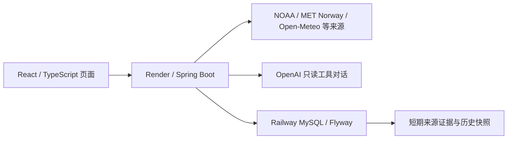

# 运行与交付说明

## 架构

AI 工具从相同的后端来源服务查询数据。聊天原文不写入运行记录；记录包括状态、规则版本、来源时间范围和最小工具证据。详情见 [运行记录设计](run-record-design-draft.md)。

## 配置

| 变量 | 用途与默认值 |
| --- | --- |
| VITE_MAPTILER_KEY | 前端底图 key，应限制允许访问的来源 |
| VITE_API_BASE_URL | 前端 API 基址，实际变量以 `frontend/src/api/apiUrl.ts` 为准 |
| OPENAI_API_KEY / OPENAI_MODEL | 仅后端保存；模型默认值见 application.properties |
| APP_ASSISTANT_GLOBAL_REQUESTS | 单实例每 10 分钟最多受理 24 次 AI 请求 |
| APP_ASSISTANT_MAX_CONCURRENT | 单实例同时处理 2 次 AI 请求 |
| APP_RUN_RECORD_ENABLED | 是否启用持久化，默认 false |
| APP_RUN_RECORD_JDBC_URL / USERNAME / PASSWORD | 数据库连接，完整 key 和 TLS 示例见 [数据库配置](database-setup.md) |
| APP_RUN_RECORD_RETENTION_DAYS | 运行记录保留 7 天；公开历史快照单独为 7 天 |

代理后的客户端 IP 尚未作为可信身份认证，多个访客可能共享客户端限流桶。全局限额独立于客户端 IP；目前为单实例设计。生产扩容前应改用共享限额存储，不能把当前限制作为多实例费用上限。

## 发布与恢复

1. 本地验证后提交推送。CI 检查后端、前端、脚本、MySQL、浏览器交互和依赖审计。
2. 核对 GitHub 提交、Vercel 发布及 Render 实际运行版本。
3. 运行 `python3 scripts/smoke_production.py --timeout 60`。脚本不调用 AI。
4. 在 Render 启动日志找 `Run-record persistence check`。首次新检查的 `previousRunId=null` 仅证明当次写入和读回；下一次部署必须读到上次的 `newRunId`，才构成跨实例持久化证据。
5. 生产启动的清理检查只构造自己的过期合成记录；清理仍遵循原有保留期，不修改用户记录时间。正常记录过期会按现有保留政策删除。
6. 若部署失败，先看首次异常和对应提交。恢复已验证版本前确认旧程序仍兼容当前 Flyway 版本。不要删除迁移历史、修改已执行迁移或自动反向迁移数据库。本次改动没有新建迁移，仍为 V1-V3。

## 备份与恢复演练

`bash scripts/check_mysql_restore.sh` 会在独立 MySQL 8.4 容器建立项目表，覆盖运行记录、两个时间快照、来源证据、工具调用和公开历史。执行事务一致的导出并恢复到另一个测试库后，逐项比较所有项目表的结构、索引、约束和有序数据，包括中文、时间微秒、小数及空值。随后验证外键拒绝孤儿记录、级联删除仍生效、公开历史不受运行记录删除影响。CI 的 MySQL 任务会运行同一演练。此脚本直接应用项目 SQL，不模拟 Flyway 迁移历史表；迁移版本与应用读回由同一任务中的 Java 集成测试覆盖。它不暴露网络端口，不使用生产凭据，成功或失败均清理容器与临时文件。

该演练证明工具流程可用，**不代表 Railway 已有自动备份或实际生产恢复演练**。生产备份应保存在受控、加密存储中，不应上传 GitHub。实际恢复应先进入隔离数据库，核对迁移版本、行数、关键关联记录及服务读回，再决定切换。备份中可能存在超出在线保留期的旧记录，需另设清理策略。

## 常见问题

- 搜索可用、AI 不可用：核对 API 响应是否为 429、模型认证/配额错误或来源超时。不要把密钥写到前端以绕过后端。
- 来源部分失败：页面保留仍有效的其他数据。不要将缺测视为数值零。
- 运行记录失败：检查公网 MySQL 连接、TLS、凭据、连接配额和迁移日志。连接池最多 3 个连接，获取连接超时为 5 秒。
- 本地测试：前端命令在 `frontend`，Maven 在 `backend`，Python 脚本在仓库根目录。不要在 backend 运行 npm。

## Railway 生产备份设置待办

2026-10-29 已通过 Railway 连接器核对：`aurora-finder` 项目的 `production` 环境中，MySQL 部署为 `SUCCESS`，`mysql-volume` 挂载在 `/var/lib/mysql`，没有待应用的配置变更。此状态不能证明已经开启备份；当前连接器没有查询或设置卷备份计划的工具。

在 [Aurora Finder Railway 项目](https://railway.com/project/a78aa031-b1bc-4909-ae4d-cbc41ed35e8d) 打开 **MySQL → Backups**：

1. 查看是否有最近的成功备份及下次计划时间，记录实际状态。
2. 如未配置，评估增量存储费用后设置 Daily。按当前官方说明，每 24 小时执行一次，保留 6 天。运行记录和公开历史本身只短期保留，不应为了备份默认增加长期留存。
3. 首次备份完成后，记录完成时间与备份 ID，才能标记生产备份已启用。每日备份意味着两次成功备份之间的新记录仍可能丢失，不等于实时恢复。
4. 恢复操作会切换数据库使用的卷并重新部署，不能当作无影响的日常检查。先审核恢复点和会丢失的新数据；切换后核对健康状态、历史记录、迁移日志与读回，保留旧卷直到确认成功。

官方说明：[Railway 卷备份](https://docs.railway.com/volumes/backups)。当前没有设置新的收费资源、自动备份计划或执行生产恢复。本仓库的隔离演练不会生成可供生产恢复的备份。
